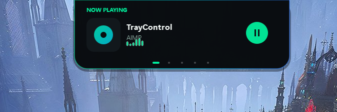
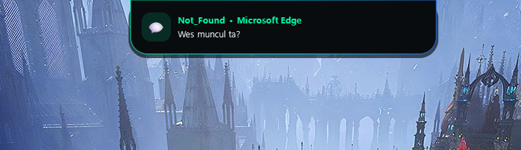
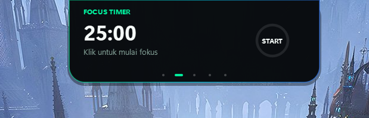
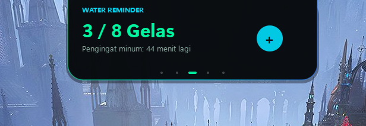
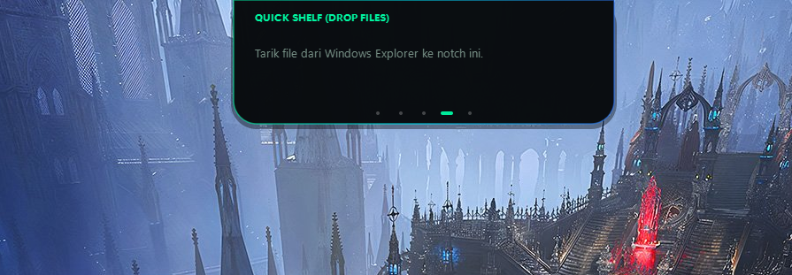

<div align="center">

# 🌿 KYO ISLAND

### *Dynamic Island buat Windows. Dingin, enteng, gak banyak drama.*

[](https://microsoft.com/windows)
[](https://github.com/oziajayakan/Dynamic-Island-Win)
[](LICENSE)
[](https://saweria.co/kyoajh)

<br/>


*🐾 Kyo Living Mascot: Profil ultra-slim 24px, nempel rapi di bezel monitor tanpa nutupin tab browser.*

**[🚀 Live Web Demo](https://dynamic-island-win.vercel.app)** • **[☕ Saweria](https://saweria.co/kyoajh)**

</div>

---

## ❄️ Apaan ini?

Gue bikin notch Dynamic Island buat Windows yang beneran fungsional, estetik, dan gak bikin laptop lu ngos-ngosan. Gak ada border norak, gak nutupin tombol minimize app lain, responsif parah, dan auto-hidden pas lu klik di luar.

- **RAM Cuma ~60MB.** Nyaris gak berasa jalan di background.
- **Tinggi cuma 24px.** Ramping, gak bakal nutupin tab browser lu.
- **Auto-Detect Everything.** Musik lokal (AIMP, Foobar, VLC), Spotify, YouTube, notifikasi WA/Telegram, sampe charger dicolok.

---

## 🥶 Visual Setup (Cold UI Gallery)

| 🎵 Now Playing (Lokal & Streaming) | 💬 Live Notification Sniffer |
| :---: | :---: |
|  |  |
| *Auto-detect Spotify, YT, AIMP, VLC, Foobar2000* | *Muncul instan nama pengirim + isi chat lengkap* |

| ⏱ Focus / Pomodoro Timer | 💧 Water Reminder |
| :---: | :---: |
|  |  |
| *Timer 25 menit. Arc bar jalan mulus 60 FPS* | *Target minum harian biar lu gak dehidrasi* |

<div align="center">

### 📁 Quick File Shelf


*Tinggal drag & drop file apapun dari Explorer ke notch, langsung nempel.*

</div>

---

## ⚡ Fitur Utama

- **🐾 Living Mascot**: Si Kyo ngedip berkala, pupil matanya ngikutin kursor mouse lu secara organik.
- **💬 Full Notification Sniffer**: Begitu ada chat WA / Telegram / Browser masuk, notch langsung nampilin **Pengirim + Isi Pesan Lengkap**, bukan cuma icon doang.
- **🎵 Dual-Engine Media Detection**:
  - Cloud: Spotify, Apple Music, YouTube di Chrome/Edge.
  - Lokal: AIMP, Foobar2000, VLC, Winamp, PotPlayer, MPC-HC, MusicBee.
- **🪄 Auto-Hidden**: Klik di luar notch? Langsung ngumpet otomatis jadi kapsul mini 24px.
- **🚀 Auto-Start**: Begitu Windows nyala, Kyo langsung standby di atas.

---

## 🛠 Cara Pasang & Pake

### 1. Clone & Install
```bash
git clone https://github.com/oziajayakan/Dynamic-Island-Win.git
cd Dynamic-Island-Win
pip install -r requirements.txt
```

### 2. Jalanin
Tinggal klik 2x file ini (jalan senyap di background tanpa pop-up CMD):
```bat
start_island.bat
```
*Mau matiin atau ganti mode? Tinggal klik kanan icon Kyo di taskbar pojok kanan bawah.*

---

## ☕ Support Developer

Kalo lu ngerasa Kyo Island bikin tampilan Windows lu jadi lebih ganteng, traktir kopi di sini:

<div align="center">

[](https://saweria.co/kyoajh)

👉 **[saweria.co/kyoajh](https://saweria.co/kyoajh)** 👈

</div>

---

<div align="center">
  <sub>MIT License • Created with cold precision by <a href="https://github.com/oziajayakan">@oziajayakan</a></sub>
</div>
