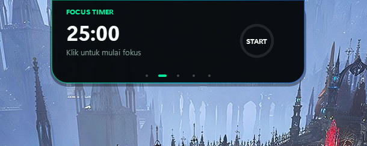
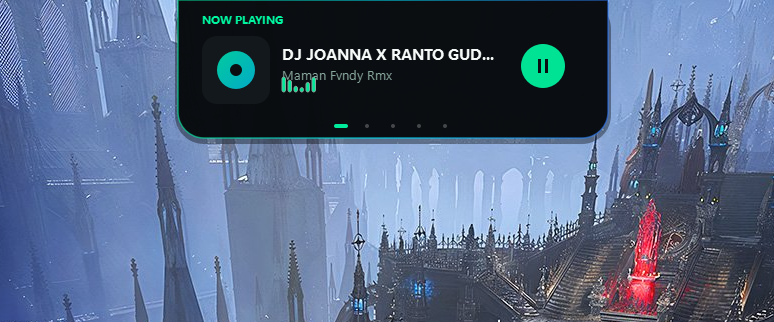
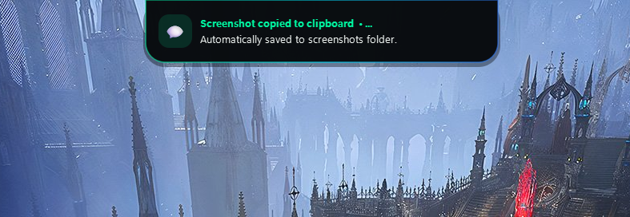
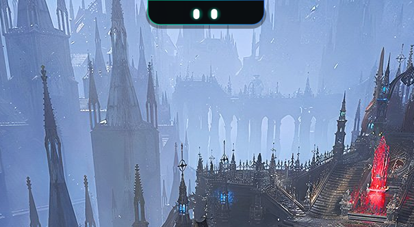
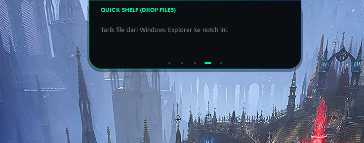
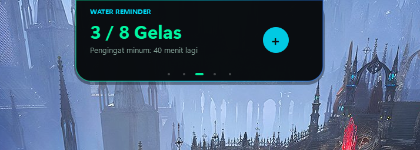

<div align="center">

# 🌿 Kyo Island (Dynamic Notch for Windows)

**A living, organic, and ultra-smooth Dynamic Island for Windows desktop.**  
*Transform the top edge of your Windows display into a natural, responsive, and tactile interactive notch.*

[](LICENSE)
[](https://microsoft.com/windows)
[](https://www.python.org/)
[](#-design-aesthetic)
[](https://saweria.co/kyoajh)

[✨ Live Website Preview](https://dynamic-island-win.vercel.app) • [📥 Download & Setup](#-installation) • [☕ Support / Donasi](#-support--donasi)

<br/>



*🐾 Kyo Living Mascot: Minimalis, halus, dan reaktif di bagian atas layar Windows Anda.*

</div>

---

## 📸 Preview Galeri

Berikut adalah tampilan nyata antarmuka modul Kyo Island saat aktif:

| 🎵 Now Playing & Media Session | ⏱ Focus / Pomodoro Timer |
| :---: | :---: |
|  |  |
| *Deteksi otomatis lagu, vinyl cover & live equalizer* | *Timer fokus 25 menit dengan circular arc progress* |

| 💧 Water Reminder | 📁 Quick File Shelf |
| :---: | :---: |
|  |  |
| *Target hidrasi harian & tombol penambah cepat (+)* | *Drag & drop berkas apapun untuk akses cepat* |

<div align="center">

### ⚡ Battery & Charger HUD


*Otomatis muncul sesaat saat kabel charger dicolok atau dicabut.*

</div>

---

## 🌟 Overview

**Kyo Island** menghadirkan pengalaman Dynamic Island modern dan elegan ke sistem operasi Windows 10 & 11. Dirancang dengan estetika bertema **"Kyo" (Natural, Cyber-Emerald & Smooth Aurora Glass)**, aplikasi ini berjalan senyap dan sangat ringan di latar belakang (*low RAM footprint ~70 MB*) tanpa membebani kinerja CPU sistem Anda.

### ✨ Fitur Unggulan

- **🐾 Living Notch Pet (Kyo Mascot)**: Maskot berkedip secara periodik dengan pandangan pupil mata yang reaktif mengikuti kursor mouse Anda secara organik.
- **💬 Real-Time Notification Sniffer**: Menangkap notifikasi masuk dari Windows (WhatsApp, Telegram, Browser, dsb) secara otomatis dan memperlihatkan **Nama Pengirim & Isi Pesan Lengkap**.
- **🎵 Windows System Media Integration**: Otomatis mendeteksi lagu atau video yang sedang diputar di Spotify, Apple Music, YouTube di Chrome/Edge, dll. Dilengkapi vinyl cover, teks lagu & artis, equalizer audio interaktif, serta kontrol Play/Pause.
- **⏱ Focus / Pomodoro Timer**: Timer fokus 25 menit dengan *circular arc progress* yang mulus.
- **💧 Smart Water Reminder**: Pelacak hidrasi harian dengan tombol penambah cepat (+) dan penghitung waktu mundur.
- **📁 Quick Shelf Drop-Zone**: Cukup seret (*drag and drop*) berkas apa saja dari File Explorer ke notch untuk disimpan sementara.
- **⚡ Battery HUD**: Indikator persentase baterai cerdas yang otomatis muncul sesaat saat laptop dicolok atau dicabut dari charger.
- **🪄 Auto-Hidden**: Notch akan otomatis menyusut kembali ke maskot Kyo Pet saat kursor menjauh atau saat Anda mengeklik di luar area notch.
- **🚀 Run on Windows Startup**: Otomatis aktif saat Windows pertama kali dinyalakan.

---

## 🎨 Design Aesthetic

Kyo Island tidak menggunakan warna monokrom atau sudut yang kaku:
- **Palette**: OLED Deep Charcoal (`#090C0F`) dipadukan dengan aksen *Cyber Emerald* (`#00F5A0`), *Electric Cyan* (`#00D9F5`), dan sentuhan *Aurora Violet*.
- **Motion**: Memanfaatkan kurva fisika pegas *Cubic Out* (60 FPS smooth interpolation) untuk respon visual yang hidup dan alami.
- **Clean Pill Design**: Menyatu rapi dengan bezel atas layar monitor tanpa sudut samping yang mengganggu.

---

## 🚀 Quick Start / Panduan Instalasi

### Prasyarat
- Windows 10 / 11 (64-bit)
- Python 3.10 atau versi lebih baru

### 1. Clone Repositori
```bash
git clone https://github.com/oziajayakan/Dynamic-Island-Win.git
cd Dynamic-Island-Win
```

### 2. Pasang Dependensi
```bash
pip install -r requirements.txt
```

### 3. Jalankan Aplikasi
- **Mode Background (Direkomendasikan)**:  
  Klik dua kali berkas:
  ```bash
  start_island.bat
  ```
- **Melalui Terminal**:
  ```bash
  python kyo_island.py
  ```

---

## 🎮 Interaksi & Kontrol

| Aksi | Efek Visual |
| :--- | :--- |
| **Hover Kursor** | Notch sedikit melebar menyambut interaksi mouse. |
| **Klik Notch Pet** | Membuka modul aktif secara instan (*Now Playing* atau *Focus Timer*). |
| **Klik di Luar Notch** | **Auto-Hidden**: Notch langsung menyusut kembali ke mode Kyo Pet yang minimalis. |
| **Drag & Drop Berkas** | Letakkan file di atas notch untuk menyimpannya di *Quick Shelf*. |
| **Klik Kanan System Tray** | Membuka menu pengaturan cepat, navigasi manual, dan tombol toggle *Run on Startup*. |

---

## 📂 Struktur Repositori

```plaintext
Dynamic-Island-Win/
├── sc/                  # Cuplikan antarmuka & galeri preview
├── kyo_island.py        # Core application (PyQt6 + Windows Media & Notification Runtime)
├── start_island.bat     # Background silent launcher (pythonw)
├── requirements.txt     # Python dependencies
├── vercel.json          # Deployment configuration for Vercel
├── index.html           # Official landing website (Vercel ready)
├── README.md            # Dokumentasi proyek
└── LICENSE              # Lisensi MIT
```

---

## ☕ Support / Donasi

Jika Anda menyukai proyek ini dan ingin mendukung pengembangannya lebih lanjut, Anda dapat memberikan apresiasi dan traktiran kopi melalui:

<div align="center">

[](https://saweria.co/kyoajh)

👉 **[Dukung kyoajh di Saweria](https://saweria.co/kyoajh)** 👈

*Dukungan dan feedback dari Anda sangat berarti untuk terus menyempurnakan Kyo Island!*

</div>

---

## 📄 Lisensi

Didistribusikan di bawah lisensi **MIT License**. Lihat file `LICENSE` untuk informasi selengkapnya.

<div align="center">
  <sub>Crafted with passion by <a href="https://github.com/oziajayakan">@oziajayakan</a></sub>
</div>
